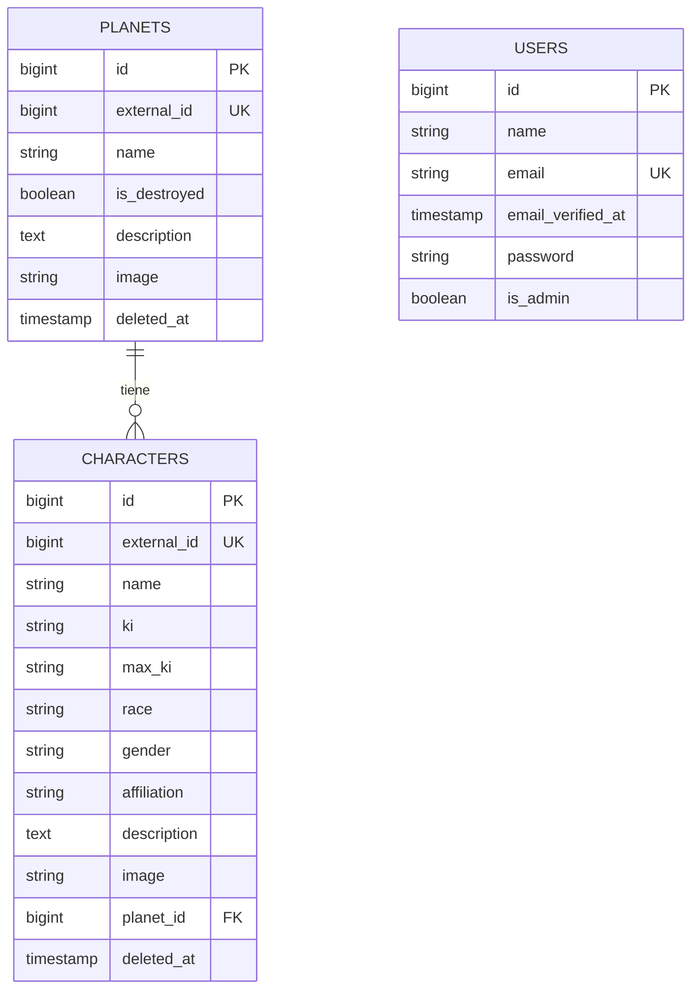

# Manual técnico – Dragon Ball App

Este manual está dirigido a desarrolladores que quieran instalar, ejecutar o continuar el proyecto. Explica cómo ponerlo en marcha, qué características tiene, cómo es el modelo de la base de datos y cómo funciona el chatbot con inteligencia artificial.

## Tecnologías

### Backend (API)

- Laravel 12 (PHP 8.2 o superior)
- MySQL como base de datos
- Laravel Sanctum: autenticación con tokens
- L5-Swagger: documentación de la API
- PHPUnit: tests
- Mailtrap: envío de emails de prueba (confirmación de cuenta)
- Google Gemini: inteligencia artificial del chat

### Frontend (web)

- Nuxt 4.5.2 (Vue 3)
- Tailwind CSS v4
- Capacitor 8: app Android

### Despliegue

- Vercel: alojamiento del backend y del frontend
- Aiven: base de datos MySQL en la nube

## Estructura del proyecto

El repositorio contiene dos proyectos independientes:

1. `dragonball-laravel/`: la API REST hecha con Laravel. Gestiona los datos, la autenticación y la conexión con Gemini.
2. `dragonball-frontend/`: la web hecha con Nuxt. No accede directamente a la base de datos: toda la información la pide a la API por HTTP.

Cada proyecto tiene sus propias dependencias y se arranca por separado.

## Puesta en marcha

### Requisitos

- PHP 8.2 o superior y Composer
- MySQL (por ejemplo, con XAMPP)
- Node.js y npm
- Git
- Una cuenta de Mailtrap (para los emails) y una API key de Google Gemini (para el chat)
- Android Studio (solo si se quiere generar la app Android)

### 1. Clonar el repositorio

```
git clone https://github.com/pm161-ual/dragonball-app.git
cd dragonball-app
```

### 2. Backend (Laravel)

1. Entrar en la carpeta e instalar dependencias:

```
cd dragonball-laravel
composer install
```

2. Crear el archivo de configuración y generar la clave de la aplicación:

```
cp .env.example .env
php artisan key:generate
```

3. Crear en MySQL una base de datos llamada `dragonball` y revisar en el `.env` las variables `DB_*`.

4. Rellenar en el `.env`:

- `MAIL_USERNAME` y `MAIL_PASSWORD`, con los datos del sandbox de Mailtrap.
- `GEMINI_API_KEY`, con la clave de Google AI Studio. `GEMINI_MODEL` ya viene configurado.
- `FRONTEND_URL`, la URL de la web (por defecto `http://localhost:3000`), a la que se redirige tras confirmar el email.

5. Crear las tablas y el usuario administrador:

```
php artisan migrate --seed
```

Esto crea el admin `admin@example.com` con contraseña `password`.

6. Importar los personajes y planetas desde dragonball-api.com:

```
php artisan dragonball:import
```

7. Arrancar el servidor:

```
php artisan serve
```

Todas las rutas de la API empiezan por `http://127.0.0.1:8000/api` (por ejemplo, `http://127.0.0.1:8000/api/characters`). La dirección `/api` sola da un 404 porque no es ninguna ruta. La documentación Swagger está en `http://127.0.0.1:8000/api/documentation`.

Para lanzar los tests (usan SQLite en memoria, así que no tocan la base de datos real):

```
php artisan test
```

### 3. Frontend (Nuxt)

1. En otra terminal:

```
cd dragonball-frontend
npm install
npm run dev
```

2. La web queda en `http://localhost:3000`.

La URL de la API se configura en `nuxt.config.ts` (`runtimeConfig.public.apiBase`). Por defecto apunta a `http://127.0.0.1:8000/api`.

**Importante:** Nuxt está fijado en la versión 4.5.2, porque la 4.6.0 da un error al arrancar el servidor de desarrollo. No actualizarlo con `npm audit fix --force`.

### 4. App Android (opcional)

```
npm run generate:android
npx cap sync android
npx cap open android
```

El primer comando genera la web estática apuntando a la API desplegada en Vercel. El segundo la copia al proyecto Android y el tercero abre Android Studio, desde donde se ejecuta en el emulador.

## Características

- CRUD completo de personajes y planetas (crear, ver, editar y borrar).
- Cambio de planeta de un personaje (campo `planet_id`).
- Borrado lógico (soft delete): los registros borrados no desaparecen de la base de datos, solo se marcan con `deleted_at`.
- Autenticación con tokens de Laravel Sanctum.
- Registro con confirmación por email mediante un enlace firmado.
- Roles: usuario normal (solo lectura) y administrador (`is_admin`), que es el único que puede crear, editar y borrar. Lo controla el middleware `admin`.
- Paginación: 12 resultados por página. En planetas se puede cambiar con `per_page`, hasta un máximo de 100.
- Filtros y ordenación por parámetros en la URL.
- Importador de datos desde dragonball-api.com (`php artisan dragonball:import`).
- Chat con IA: los personajes responden con Google Gemini, con respuesta en streaming.
- Límite de peticiones en el chat: 10 mensajes por minuto.
- Documentación Swagger de todos los endpoints.
- Tests automáticos con PHPUnit.
- Despliegue en Vercel y app Android con Capacitor.

## Endpoints

Todas las rutas empiezan por `/api`. La documentación completa, con ejemplos y la opción de probarlos, está en Swagger.

### Públicos

- `GET /characters`: lista de personajes. Filtros: `name`, `race`, `gender`, `affiliation`, `planet_id`. Orden: `sort` (`name`, `race`, `gender`, `affiliation`) y `direction` (`asc`/`desc`).
- `GET /characters/{id}`: detalle de un personaje, con su planeta.
- `GET /planets`: lista de planetas. Filtros: `name`, `is_destroyed`. Orden: `sort` (`name`, `is_destroyed`, `characters_count`) y `direction`. Paginación: `per_page`.
- `GET /planets/{id}`: detalle de un planeta, con sus habitantes.
- `POST /register`: registro de usuario.
- `GET /email/verify/{id}/{hash}`: confirmación del email (es el enlace del correo).
- `POST /login`: devuelve el token.

### Con sesión

Requieren la cabecera `Authorization: Bearer <token>`.

- `POST /logout`
- `POST /chat`: respuesta completa de la IA.
- `POST /chat/stream`: respuesta de la IA en streaming (SSE).

### Solo administrador

- `POST /characters`, `PUT /characters/{id}`, `DELETE /characters/{id}`
- `POST /planets`, `PUT /planets/{id}`, `DELETE /planets/{id}`

## Modelo de base de datos

La base de datos tiene tres tablas propias del proyecto: `users`, `planets` y `characters`. Además están las tablas que crea Laravel (`personal_access_tokens` para los tokens de Sanctum, `sessions`, `cache`, `jobs`, etc.).



### planets

| Campo | Descripción |
|---|---|
| `id` | Identificador |
| `external_id` | ID del planeta en dragonball-api.com (único). Sirve para que el importador no duplique datos |
| `name` | Nombre |
| `is_destroyed` | Si el planeta está destruido (por defecto `false`) |
| `description` | Descripción |
| `image` | URL de la imagen |
| `created_at`, `updated_at` | Fechas de creación y modificación |
| `deleted_at` | Fecha de borrado lógico (soft delete) |

### characters

| Campo | Descripción |
|---|---|
| `id` | Identificador |
| `external_id` | ID del personaje en dragonball-api.com (único) |
| `name` | Nombre |
| `ki`, `max_ki` | Ki y ki máximo. Son texto porque la API externa los da con formatos como "60.000.000" o "Billion" |
| `race`, `gender`, `affiliation` | Raza, género y afiliación |
| `description` | Descripción |
| `image` | URL de la imagen |
| `planet_id` | Planeta de origen (clave foránea a `planets`, puede ser nulo) |
| `created_at`, `updated_at`, `deleted_at` | Fechas, igual que en planets |

### users

| Campo | Descripción |
|---|---|
| `id`, `name`, `email` | Datos del usuario (el email es único) |
| `email_verified_at` | Fecha de confirmación del email. Si es nulo, el usuario no puede iniciar sesión |
| `password` | Contraseña cifrada (hash) |
| `is_admin` | Rol: `true` = administrador, `false` = usuario normal (por defecto) |

### Relaciones

- Un planeta tiene muchos personajes (`Planet hasMany Character`) y un personaje pertenece a un planeta (`Character belongsTo Planet`).
- Cambiar de planeta a un personaje es simplemente cambiar su `planet_id`.
- No se puede borrar un planeta que tenga personajes: la API responde `409`. Además, la clave foránea tiene `nullOnDelete`, por si se borrara de forma definitiva.
- Personajes y planetas usan borrado lógico (`SoftDeletes`): al borrar se rellena `deleted_at` y el registro deja de aparecer en la API, pero sigue en la base de datos.

## Chatbot con inteligencia artificial

Cada personaje tiene un chat en su página de detalle. Las respuestas las genera **Google Gemini**, que actúa como el personaje usando los datos guardados en nuestra base de datos.

### Arquitectura

El frontend **nunca** habla directamente con Gemini. Laravel hace de intermediario (proxy):

```
Nuxt (ChatPersonaje.vue)  →  Laravel (/api/chat/stream)  →  Google Gemini
         ↑                              |
         └──────── respuesta en trozos (SSE) ────────┘
```

Así la clave `GEMINI_API_KEY` se queda en el `.env` del servidor y no se expone en el navegador.

### Configuración

- `.env`: `GEMINI_API_KEY` (clave de Google AI Studio) y `GEMINI_MODEL` (por defecto `gemini-3.5-flash-lite`).
- `config/services.php`: lee esas dos variables en `services.gemini`.
- `routes/api.php`: las rutas `/chat` y `/chat/stream` llevan los middlewares `auth:sanctum` (hay que tener sesión) y `throttle:10,1` (máximo 10 mensajes por minuto, para no gastar la cuota de la API).

### Backend: ChatController

El controlador tiene dos métodos públicos y dos privados que comparten:

- **`validar()`**: comprueba la petición.
  - `character_id`: obligatorio, debe existir en `characters`.
  - `message`: obligatorio, máximo 1000 caracteres.
  - `history`: opcional, máximo 20 mensajes. Cada uno con `role` (`user` o `model`) y `text`.
- **`cuerpoGemini()`**: construye el JSON que se envía a Gemini.
  - **`system_instruction`**: las instrucciones del personaje, creadas con los datos de la base de datos (nombre, raza, ki, afiliación y descripción). Se le pide que responda en español, con la personalidad del personaje, en 2 a 4 frases y sin salir nunca del papel.
  - **`contents`**: el historial de la conversación más el mensaje nuevo. Como la API de Gemini no guarda memoria, el historial se envía en cada petición.
- **`chat()`**: llama a `:generateContent` y devuelve la respuesta completa en `{ "reply": "..." }`.
- **`chatStream()`**: llama a `:streamGenerateContent?alt=sse` con `stream => true` y devuelve un `response()->stream()`:
  1. Lee la respuesta de Gemini por bloques.
  2. Separa los eventos por saltos de línea y se queda con las líneas que empiezan por `data: `.
  3. Extrae el texto de cada trozo y lo reenvía al frontend como `data: {"reply":"..."}`.
  4. Hace `flush()` para enviar cada trozo en cuanto llega.
  5. Al terminar envía `data: [DONE]`.

  Las cabeceras `Content-Type: text/event-stream`, `Cache-Control: no-cache` y `X-Accel-Buffering: no` evitan que el servidor acumule la respuesta antes de enviarla.

**Errores**: si Gemini no responde (timeout de 30 segundos) o devuelve un error, la API responde `502` con el mensaje "El personaje no puede responder ahora mismo.".

### Frontend: ChatPersonaje.vue

Componente que se muestra en `/personajes/[id]`.

- Si no hay token, muestra un enlace para iniciar sesión.
- Guarda los mensajes en un `ref` (`mensajes`), así que la conversación se pierde al recargar la página.
- Al enviar:
  1. Añade el mensaje del usuario a la lista y activa `escribiendo` (aparece "[nombre] está escribiendo..." y el botón se desactiva).
  2. Hace un `fetch` POST a `/chat/stream` con el token, el `character_id`, el mensaje y los últimos 20 mensajes como historial.
  3. Lee la respuesta con `getReader()` y `TextDecoder`, separa los eventos por `\n\n` y va añadiendo cada `reply` al último mensaje, que se pinta en pantalla mientras llega.
  4. Si la respuesta es `429` muestra "Demasiados mensajes. Espera un minuto."; con cualquier otro error, "[nombre] no puede responder ahora mismo.".

Se usa `fetch` en lugar de `$fetch` porque `$fetch` espera la respuesta completa, mientras que `fetch` permite leer el cuerpo por trozos.

### Despliegue

En Vercel, `vercel.json` tiene `maxDuration: 30` para que la función PHP pueda mantener abierta la conexión mientras Gemini responde.

### Tests

`tests/Feature/ChatTest.php` usa `Http::fake()` para simular a Gemini sin gastar cuota:

- La respuesta del personaje se devuelve correctamente.
- Sin token devuelve `401`.
- El streaming devuelve los trozos en formato SSE.

